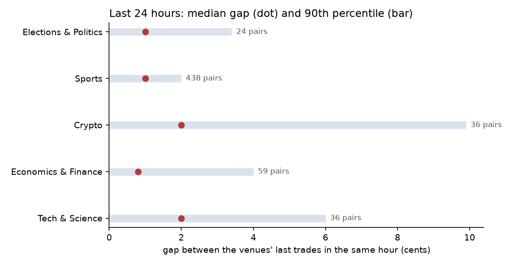

# Kairos cross-venue report, 2026-11-20

Generated 2026-11-20 19:40 UTC from Kairos's catalog of linked markets, Market Data API and fee quotes, and Kalshi and Polymarket order books. Pairs are grouped into [Prediction@Illinois](https://prediction-illinois.github.io)'s six market divisions by Kairos's own categories.

## Overview

| Division | Pairs Kairos lists | Lined up | Edge after fees, confirmed | Median gap, last 24 h | Settled the same way, last 7 days |
|---|---|---|---|---|---|
| Elections & Politics | 862 | 516 | 0 of 191 | 1.0¢ (23 pairs) | 10 of 10 |
| Sports | 3,101 | 2,703 | 0 of 1,389 | 1.0¢ (587 pairs) | 9,813 of 9,847 |
| Crypto | 1,185 | 1,185 | 0 of 294 | 2.6¢ (40 pairs) | 3,564 of 4,026 |
| Economics & Finance | 444 | 383 | 0 of 213 | 1.0¢ (39 pairs) | 224 of 227 |
| Tech & Science | 547 | 541 | 0 of 93 | 1.1¢ (39 pairs) | 522 of 522 |
| Climate & Weather | 0 | 0 | – | – | – |

Another 463 pairs fall outside the six divisions (Culture 463, Entertainment 156, Financials 23, Science and Technology 1).

## Pairs

Kairos listed 6,602 matched pairs across 6 venue combinations; oracle3-extras lined up the outcomes of 5,611 (85%), 91 of them with a warning such as a postponed game.

| Division | Venues | Lined up |
|---|---|---|
| Elections & Politics | Polymarket–Predict.fun | 516 of 517 |
| Elections & Politics | Kalshi–Polymarket | 0 of 173 |
| Elections & Politics | Kalshi–Predict.fun | 0 of 172 |
| Sports | Polymarket–Predict.fun | 1,390 of 1,392 |
| Sports | Kalshi–Polymarket | 884 of 886 |
| Sports | Kalshi–Predict.fun | 375 of 550 |
| Sports | Polymarket–Hyperliquid | 0 of 92 |
| Sports | Predict.fun–Hyperliquid | 54 of 92 |
| Sports | Kalshi–Hyperliquid | 0 of 89 |
| Crypto | Polymarket–Predict.fun | 1,185 of 1,185 |
| Economics & Finance | Polymarket–Predict.fun | 383 of 383 |
| Economics & Finance | Kalshi–Predict.fun | 0 of 42 |
| Economics & Finance | Kalshi–Polymarket | 0 of 19 |
| Tech & Science | Polymarket–Predict.fun | 541 of 541 |
| Tech & Science | Kalshi–Polymarket | 0 of 5 |
| Tech & Science | Kalshi–Predict.fun | 0 of 1 |
| Other | Polymarket–Predict.fun | 283 of 283 |
| Other | Kalshi–Polymarket | 0 of 103 |
| Other | Kalshi–Predict.fun | 0 of 77 |

| Not lined up | Pairs |
|---|---|
| not a sports market; questions not compared | 592 |
| different dates | 182 |
| could not confirm both markets ask about the same team | 174 |
| could not line up the outcomes | 39 |
| different periods (for example half vs full game) | 2 |
| Polymarket market not found | 1 |
| different start times | 1 |

## Live check

Each pair is priced on both venues and checked for a basket that pays more than it costs after both venues' fees. Kalshi and Polymarket have public order books, so their edges are walked down the books. Predict.fun is priced from its last trades, which can be weeks old; the largest of those edges are confirmed with Kairos fee quotes, which walk the live Predict.fun book.

| Division | Priced on live books | Edge after fees | Left after the books | Priced from last trades | Edge on last trades | Checked with fee quotes | Confirmed |
|---|---|---|---|---|---|---|---|
| Elections & Politics | 0 | 0 | 0 | 191 | 153 | 13 | 0 |
| Sports | 884 | 5 | 0 | 505 | 95 | 0 | 0 |
| Crypto | 0 | 0 | 0 | 294 | 171 | 5 | 0 |
| Economics & Finance | 0 | 0 | 0 | 213 | 147 | 16 | 0 |
| Tech & Science | 0 | 0 | 0 | 93 | 75 | 6 | 0 |
| Other | 0 | 0 | 0 | 68 | 52 | 10 | 0 |

Not priced: no Predict.fun trades yet 3,307; no live quotes for Hyperliquid yet 54; polymarket market not found 2.

Most edges at the top of the book disappear after fees, in the order books, or once a stale last trade meets the live book.

## Price agreement, last 24 hours

For every pair, both venues' last trades in each hour of the last 24 hours, up to the event's start (a game under way is compared on its pre-game prices only).

| Division | Pairs compared | Hours compared | Median gap | 90th percentile | Hours 2¢ or more apart |
|---|---|---|---|---|---|
| Elections & Politics | 23 | 49 | 1.0¢ | 3.0¢ | 31% |
| Sports | 587 | 3,237 | 1.0¢ | 2.0¢ | 16% |
| Crypto | 40 | 59 | 2.6¢ | 16¢ | 59% |
| Economics & Finance | 39 | 137 | 1.0¢ | 2.8¢ | 21% |
| Tech & Science | 39 | 75 | 1.1¢ | 5.0¢ | 31% |
| Other | 14 | 36 | 2.2¢ | 43¢ | 61% |

| Division | Venues | Pairs compared | Median gap | 90th percentile |
|---|---|---|---|---|
| Elections & Politics | Polymarket–Predict.fun | 23 | 1.0¢ | 3.0¢ |
| Sports | Kalshi–Polymarket | 293 | 1.0¢ | 2.0¢ |
| Sports | Kalshi–Predict.fun | 88 | 1.0¢ | 2.0¢ |
| Sports | Polymarket–Predict.fun | 188 | 1.0¢ | 2.0¢ |
| Sports | Predict.fun–Hyperliquid | 18 | 0.7¢ | 1.5¢ |
| Crypto | Polymarket–Predict.fun | 40 | 2.6¢ | 16¢ |
| Economics & Finance | Polymarket–Predict.fun | 39 | 1.0¢ | 2.8¢ |
| Tech & Science | Polymarket–Predict.fun | 39 | 1.1¢ | 5.0¢ |
| Other | Polymarket–Predict.fun | 14 | 2.2¢ | 43¢ |

| Most persistent gaps (at least 3 hours compared) | Division | Venues | Median gap | Hours |
|---|---|---|---|---|
| Will "Mo Bamba" by Sheck Wes be on the radio in GTA VI at launch? | Other | Polymarket–Predict.fun | 20¢ | 7 |
| Will Bitcoin dip to $57,500 in November? | Crypto | Polymarket–Predict.fun | 9.1¢ | 4 |
| Counter-Strike: TTG Esports vs NoTime (BO3) - CCT Europe Contenders #11 Playoffs | Sports | Kalshi–Predict.fun | 6.0¢ | 3 |
| Variational FDV above $1B one day after launch? | Crypto | Polymarket–Predict.fun | 5.7¢ | 3 |
| Bitcoin Up or Down on November 21? | Crypto | Polymarket–Predict.fun | 5.0¢ | 5 |
| Counter-Strike: Hermine Esports Club vs ENCELADE (BO3) - CCT Europe Contenders #11 Playoffs | Sports | Kalshi–Polymarket | 4.0¢ | 8 |
| Will Anthropic's valuation hit (LOW) $800B by December 31? | Economics & Finance | Polymarket–Predict.fun | 3.1¢ | 5 |
| Counter-Strike: QUINTESSÊNCIA vs Rush (BO3) - Gamers Club Liga Série A Group C | Sports | Kalshi–Predict.fun | 3.0¢ | 4 |

## Sports around game time

Games that started 6 to 30 hours ago: 477 of 727 pairs traded on both venues in the same minute, 18,156 minutes in all. The median gap between the two last trades was 1.0¢ and the 90th percentile 4.0¢; before the start the 90th percentile was 2.0¢.

| Venues | Pairs compared | Minutes | Median gap | 90th percentile |
|---|---|---|---|---|
| Kalshi–Polymarket | 265 | 13,829 | 1.0¢ | 4.0¢ |
| Polymarket–Predict.fun | 212 | 4,327 | 1.0¢ | 4.0¢ |

| Most persistent gaps (at least 10 minutes compared) | Venues | Median gap | Largest | Minutes |
|---|---|---|---|---|
| Valorant: Ambitious Legend Gaming vs LNG Esports (BO3) - China National Tournament Split Omega: Pro Division Group A | Polymarket–Predict.fun | 5.0¢ | 8.0¢ | 12 |
| Counter-Strike: Fortress vs aimers (BO1) - ESEA Advanced Europe Regular Season | Kalshi–Polymarket | 5.0¢ | 32¢ | 18 |
| Counter-Strike: gothboiclique vs VTK (BO3) - CCT Europe Contenders #11 Playoffs | Polymarket–Predict.fun | 5.0¢ | 30¢ | 11 |
| KHL: Ak Bars Kazan vs. Spartak Moscow | Kalshi–Polymarket | 4.7¢ | 13¢ | 22 |
| Counter-Strike: LPH Gaming vs The Chosen Few (BO1) - ESEA Advanced Europe Regular Season | Kalshi–Polymarket | 4.7¢ | 72¢ | 31 |

These are trade prices up to a minute apart, not quotes: a gap shows the venues disagreeing, not an arbitrage that could have been executed.

## Trading activity

24-hour volume from Kairos trade metrics for up to 40 pairs per division, chosen at random each day.

| Division | Venue | Markets sampled | Traded in the last 24 h | Median 24 h volume of those |
|---|---|---|---|---|
| Elections & Politics | Polymarket | 40 | 22 of 40 | $74.60 |
| Elections & Politics | Predict.fun | 40 | 0 of 40 | – |
| Sports | Kalshi | 21 | 13 of 21 | $714 |
| Sports | Polymarket | 36 | 16 of 36 | $55.34 |
| Sports | Predict.fun | 23 | 6 of 23 | $812 |
| Crypto | Polymarket | 40 | 5 of 40 | $69.01 |
| Crypto | Predict.fun | 40 | 1 of 40 | $561 |
| Economics & Finance | Polymarket | 40 | 23 of 40 | $1,449 |
| Economics & Finance | Predict.fun | 40 | 6 of 40 | $566 |
| Tech & Science | Polymarket | 40 | 21 of 40 | $482 |
| Tech & Science | Predict.fun | 40 | 2 of 40 | $16.80 |
| Other | Polymarket | 40 | 28 of 40 | $253 |
| Other | Predict.fun | 40 | 4 of 40 | $359 |

## Settlement

Events that started in the last seven days: 14,705 pairs have settled on both venues and 14,206 settled the same way (97%); 250 are still settling or have no result from Kairos.

| Division | Settled on both venues | Same way | Still settling |
|---|---|---|---|
| Elections & Politics | 10 | 10 | 2 |
| Sports | 9,847 | 9,813 | 93 |
| Crypto | 4,026 | 3,564 | 0 |
| Economics & Finance | 227 | 224 | 0 |
| Tech & Science | 522 | 522 | 155 |
| Other | 73 | 73 | 0 |

| Venue | Markets looked up | Resolved |
|---|---|---|
| Kalshi | 3,204 | 3,203 |
| Polymarket | 14,392 | 14,176 |
| Predict.fun | 12,292 | 12,083 |
| Hyperliquid | 22 | 0 |

| Market A | Market B | Venues | A first outcome paid | B first outcome paid |
|---|---|---|---|---|
| Alejandro Davidovich Fokina wins | Rolex Paris Masters: Alejandro Davidovich Fokina vs Moise Kouame | kalshi + predictfun | 0.74 | 0.5 |
| Daniel Merida wins | Rolex Paris Masters: Daniel Merida Aguilar vs Alexander Blockx | kalshi + predictfun | 0.42 | 0.5 |
| Stefanos Tsitsipas wins | Rolex Paris Masters: Stefanos Tsitsipas vs Learner Tien | kalshi + predictfun | 0.45 | 0.5 |
| Nazim Sadykhov wins | UFC 334: Nazim Sadykhov vs. Jefferson Nascimento (Lightweight, Early Prelims) | kalshi + polymarket | 0.7 | 0.5 |
| Adrian Yanez wins | UFC 334: Adrian Yañez vs. Juan Diaz (Bantamweight, Early Prelims) | kalshi + polymarket | 0.53 | 0.5 |
| Matteo Berrettini wins | Rolex Paris Masters: Matteo Berrettini vs Carlos Alcaraz | kalshi + predictfun | 0.16 | 0.5 |
| BORRACHEIROS wins | Counter-Strike: BORRACHEIROS vs your end (BO3) - CCT South America Group Stage | kalshi + predictfun | 0.7 | 0.5 |
| Washington wins | Washington Huskies vs. Utah Utes | kalshi + polymarket | 0.41 | 0.5 |
| Washington wins | Washington Huskies vs. Utah Utes | kalshi + predictfun | 0.41 | 0.5 |
| MOUZ NXT wins | Counter-Strike: MOUZ NXT vs Sökerorg (BO3) - CCT Europe Group Stage | kalshi + predictfun | 0.48 | 0.5 |

## Notes for Kairos

- No matched pairs in Climate & Weather.
- Every Hyperliquid pair (273) is Sports.
- 1,067 pairs carry a different category on each side (406 of them point to different divisions); for example "Will Bloomberg IPO by December 31, 2026?" is Tech on Polymarket and Finance on Predict.fun; "Will the U.S. confirm that aliens exist before 2027?" is Science and Technology on Kalshi and Politics on Polymarket; "Will the US confirm that aliens exist before 2027?" is Politics on Polymarket and Culture on Predict.fun.
- 31 pairs have a category on one side only (side without one: Predict.fun 31).
- 92 Polymarket–Hyperliquid pairs are matched across different dates; for example "Bundesliga Matchday 10: FC Bayern Munich v FC Köln: FC Köln" and "Will 1. FC Köln win on 2026-11-20?" (Polymarket 2026-11-20, Hyperliquid 2027-02-20).
- 89 Kalshi–Hyperliquid pairs are matched across different dates; for example "Bundesliga Matchday 10: FC Bayern Munich v FC Köln: FC Köln" and "FC Köln wins" (Kalshi 2026-11-20, Hyperliquid 2027-02-20).
- 1 Kalshi–Predict.fun pairs are matched across different dates; for example "Spirit Academy wins" and "Dota 2: Spirit Academy vs Team Allied (BO3) - European Pro League Group A" (Kalshi 2026-11-22, Predict.fun 2026-11-17).
- 806 more pairs could not be confirmed automatically and were left out (see "Not lined up" above).
- 3,307 of 4,727 pairs with a Predict.fun side have no Predict.fun trades yet (no mark), so they cannot be priced.
- No resolutions came back for Hyperliquid (22 markets whose events started 6 hours to 7 days before the report).

## Method

- Pairs come from Kairos's approved links (`/market-links`; `/matched-markets` until 11 November 2026), every two venues of a link making one pair, and outside sports from Kairos's equivalence clusters around every non-sports Predict.fun market; [oracle3-extras](https://github.com/YichengYang-Ethan/oracle3-extras) checks each one on both venues and decides which outcome of market B pays when market A's first outcome pays.
- Divisions follow Kairos's categories (Politics and World: Elections & Politics; Sports and Esports: Sports; Finance: Economics & Finance; Tech and Science: Tech & Science). When the two sides disagree, Sports comes first, then Climate & Weather, Economics & Finance, Elections & Politics, Tech & Science and Crypto.
- The live check uses each venue's published fee schedule (oracle3), Kalshi and Polymarket order books, Kairos marks for Predict.fun last trades and Kairos fee quotes to confirm them.
- Price agreement uses Kairos hourly candles; the sports section uses one-minute candles; trading activity uses `/v1/trades/metrics`; settlement uses `/v1/resolutions`.
- Only aggregates and a few example rows are published here.
