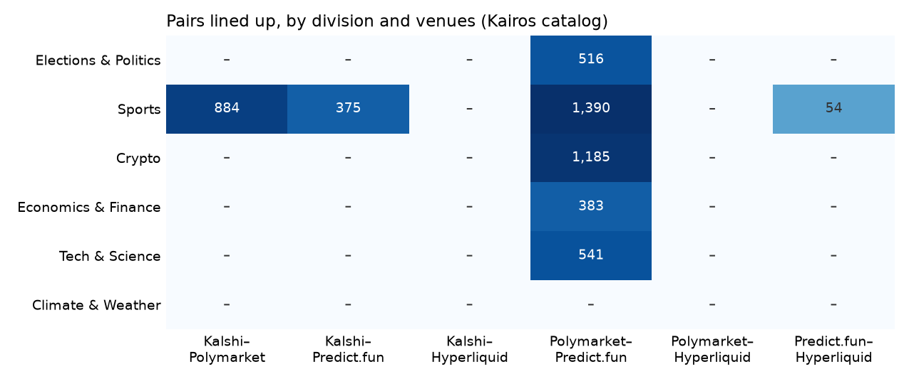
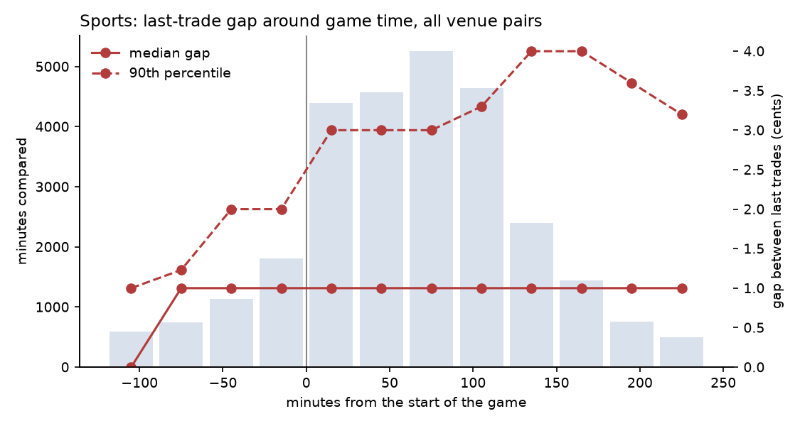

# Kairos cross-venue report, 2026-11-18

Generated 2026-11-18 20:03 UTC from Kairos's catalog of linked markets, Market Data API and fee quotes, and Kalshi and Polymarket order books. Pairs are grouped into [Prediction@Illinois](https://prediction-illinois.github.io)'s six market divisions by Kairos's own categories.

## Overview

| Division | Pairs Kairos lists | Lined up | Edge after fees, confirmed | Median gap, last 24 h | Settled the same way, last 7 days |
|---|---|---|---|---|---|
| Elections & Politics | 762 | 418 | 0 of 188 | 1.0¢ (24 pairs) | 10 of 10 |
| Sports | 3,024 | 2,638 | 1 of 1,316 | 1.0¢ (438 pairs) | 12,585 of 12,622 |
| Crypto | 1,192 | 1,192 | 0 of 293 | 2.0¢ (36 pairs) | 2,042 of 2,304 |
| Economics & Finance | 609 | 544 | 0 of 246 | 0.8¢ (59 pairs) | 131 of 134 |
| Tech & Science | 642 | 636 | 0 of 108 | 2.0¢ (36 pairs) | 159 of 159 |
| Climate & Weather | 0 | 0 | – | – | – |

Another 430 pairs fall outside the six divisions (Culture 430, Entertainment 158, Financials 23, Science and Technology 1).

## Pairs

Kairos listed 6,659 matched pairs across 6 venue combinations; oracle3-extras lined up the outcomes of 5,676 (85%), 224 of them with a warning such as a postponed game.

| Division | Venues | Lined up |
|---|---|---|
| Elections & Politics | Polymarket–Predict.fun | 418 of 419 |
| Elections & Politics | Kalshi–Polymarket | 0 of 172 |
| Elections & Politics | Kalshi–Predict.fun | 0 of 171 |
| Sports | Polymarket–Predict.fun | 1,330 of 1,330 |
| Sports | Kalshi–Polymarket | 894 of 896 |
| Sports | Kalshi–Predict.fun | 357 of 511 |
| Sports | Polymarket–Hyperliquid | 0 of 96 |
| Sports | Predict.fun–Hyperliquid | 57 of 96 |
| Sports | Kalshi–Hyperliquid | 0 of 95 |
| Crypto | Polymarket–Predict.fun | 1,192 of 1,192 |
| Economics & Finance | Polymarket–Predict.fun | 544 of 544 |
| Economics & Finance | Kalshi–Predict.fun | 0 of 44 |
| Economics & Finance | Kalshi–Polymarket | 0 of 21 |
| Tech & Science | Polymarket–Predict.fun | 636 of 636 |
| Tech & Science | Kalshi–Polymarket | 0 of 5 |
| Tech & Science | Kalshi–Predict.fun | 0 of 1 |
| Other | Polymarket–Predict.fun | 248 of 248 |
| Other | Kalshi–Polymarket | 0 of 104 |
| Other | Kalshi–Predict.fun | 0 of 78 |

| Not lined up | Pairs |
|---|---|
| not a sports market; questions not compared | 596 |
| different dates | 191 |
| could not confirm both markets ask about the same team | 152 |
| could not line up the outcomes | 40 |
| Kalshi market is finalized | 2 |
| Kalshi market is inactive | 2 |

## Live check

Each pair is priced on both venues and checked for a basket that pays more than it costs after both venues' fees. Kalshi and Polymarket have public order books, so their edges are walked down the books. Predict.fun is priced from its last trades, which can be weeks old; the largest of those edges are confirmed with Kairos fee quotes, which walk the live Predict.fun book.

| Division | Priced on live books | Edge after fees | Left after the books | Priced from last trades | Edge on last trades | Checked with fee quotes | Confirmed |
|---|---|---|---|---|---|---|---|
| Elections & Politics | 0 | 0 | 0 | 188 | 143 | 13 | 0 |
| Sports | 894 | 9 | 1 | 422 | 98 | 2 | 0 |
| Crypto | 0 | 0 | 0 | 293 | 165 | 6 | 0 |
| Economics & Finance | 0 | 0 | 0 | 246 | 169 | 16 | 0 |
| Tech & Science | 0 | 0 | 0 | 108 | 64 | 6 | 0 |
| Other | 0 | 0 | 0 | 52 | 39 | 7 | 0 |

Not priced: no Predict.fun trades yet 3,416; no live quotes for Hyperliquid yet 57.

| Division | Venues | Market A | Market B | Basket | Contracts | Net edge | Checked with | Closes |
|---|---|---|---|---|---|---|---|---|
| Sports | Kalshi–Polymarket | Carlos Alcaraz wins | ATP World Tour Finals, Ivan Lendl Group: Carlos Alcaraz vs Flavio Cobolli | NO on A + YES on B | 0.04 | $0.0007 | order books | 2026-11-24 |

Net edge is for all the contracts together. It assumes every leg fills at the prices used, both markets settle the same way, and money tied up until settlement costs nothing, which matters for markets that close years from now. Closes is the earlier of the two markets' closing times.

Most edges at the top of the book disappear after fees, in the order books, or once a stale last trade meets the live book.

## Price agreement, last 24 hours

For every pair, both venues' last trades in each hour of the last 24 hours, up to the event's start (a game under way is compared on its pre-game prices only).

| Division | Pairs compared | Hours compared | Median gap | 90th percentile | Hours 2¢ or more apart |
|---|---|---|---|---|---|
| Elections & Politics | 24 | 41 | 1.0¢ | 3.4¢ | 32% |
| Sports | 438 | 2,319 | 1.0¢ | 2.0¢ | 16% |
| Crypto | 36 | 56 | 2.0¢ | 9.9¢ | 57% |
| Economics & Finance | 59 | 282 | 0.8¢ | 4.0¢ | 23% |
| Tech & Science | 36 | 65 | 2.0¢ | 6.0¢ | 51% |
| Other | 18 | 41 | 0.3¢ | 3.3¢ | 20% |

| Division | Venues | Pairs compared | Median gap | 90th percentile |
|---|---|---|---|---|
| Elections & Politics | Polymarket–Predict.fun | 24 | 1.0¢ | 3.4¢ |
| Sports | Kalshi–Polymarket | 222 | 1.0¢ | 2.0¢ |
| Sports | Kalshi–Predict.fun | 56 | 1.0¢ | 2.0¢ |
| Sports | Polymarket–Predict.fun | 133 | 1.0¢ | 2.0¢ |
| Sports | Predict.fun–Hyperliquid | 27 | 0.5¢ | 1.1¢ |
| Crypto | Polymarket–Predict.fun | 36 | 2.0¢ | 9.9¢ |
| Economics & Finance | Polymarket–Predict.fun | 59 | 0.8¢ | 4.0¢ |
| Tech & Science | Polymarket–Predict.fun | 36 | 2.0¢ | 6.0¢ |
| Other | Polymarket–Predict.fun | 18 | 0.3¢ | 3.3¢ |

| Most persistent gaps (at least 3 hours compared) | Division | Venues | Median gap | Hours |
|---|---|---|---|---|
| Will Jensen Huang publicly testify before Congress by December 31, 2026? | Elections & Politics | Polymarket–Predict.fun | 11¢ | 3 |
| Will Solana hit $60 or $140 first? | Crypto | Polymarket–Predict.fun | 9.9¢ | 3 |
| Dota 2: CyberHero vs Inner Circle (BO3) - DreamLeague Division 2 Playoffs | Sports | Kalshi–Predict.fun | 8.0¢ | 7 |
| Dota 2: Team Spirit vs PARIVISION (BO5) - 1win Essence Playoffs | Sports | Kalshi–Predict.fun | 5.0¢ | 5 |
| Jensen Huang rejoins NVIDIA before divorce? | Tech & Science | Polymarket–Predict.fun | 5.0¢ | 3 |
| ATP World Tour Finals, Ivan Lendl Group: Daniil Medvedev vs Frances Tiafoe | Sports | Kalshi–Polymarket | 4.0¢ | 6 |
| Will Anthropic’s market cap be between 1.2T and 1.5T at market close on IPO day by December 31 2027? | Economics & Finance | Polymarket–Predict.fun | 3.9¢ | 19 |
| Bitcoin Up or Down on November 19? | Crypto | Polymarket–Predict.fun | 3.0¢ | 5 |

## Sports around game time

Games that started 6 to 30 hours ago: 949 of 1,994 pairs traded on both venues in the same minute, 30,329 minutes in all. The median gap between the two last trades was 1.0¢ and the 90th percentile 3.0¢; before the start the 90th percentile was 2.0¢.

| Venues | Pairs compared | Minutes | Median gap | 90th percentile |
|---|---|---|---|---|
| Kalshi–Polymarket | 428 | 20,761 | 1.0¢ | 3.0¢ |
| Polymarket–Predict.fun | 521 | 9,568 | 1.0¢ | 3.1¢ |

| Most persistent gaps (at least 10 minutes compared) | Venues | Median gap | Largest | Minutes |
|---|---|---|---|---|
| Metz: Pedro Martinez vs Matthew William Donald | Kalshi–Polymarket | 19¢ | 20¢ | 10 |
| Valorant: Ambitious Legend Gaming vs SEC (BO3) - China National Tournament Split Omega: Pro Division Group A | Kalshi–Polymarket | 6.0¢ | 28¢ | 32 |
| Valorant: Ambitious Legend Gaming vs SEC (BO3) - China National Tournament Split Omega: Pro Division Group A | Polymarket–Predict.fun | 5.3¢ | 29¢ | 10 |
| Counter-Strike: Nice Try vs ex-RUSTEC - Map 1 Winner | Polymarket–Predict.fun | 5.0¢ | 13¢ | 10 |
| Counter-Strike: Team Bratishkin vs Team PCH3LK1N - Map 2 Winner | Polymarket–Predict.fun | 4.3¢ | 18¢ | 16 |

These are trade prices up to a minute apart, not quotes: a gap shows the venues disagreeing, not an arbitrage that could have been executed.

## Trading activity

24-hour volume from Kairos trade metrics for up to 40 pairs per division, chosen at random each day.

| Division | Venue | Markets sampled | Traded in the last 24 h | Median 24 h volume of those |
|---|---|---|---|---|
| Elections & Politics | Polymarket | 40 | 27 of 40 | $1,010 |
| Elections & Politics | Predict.fun | 40 | 4 of 40 | $121 |
| Sports | Kalshi | 21 | 11 of 21 | $83.04 |
| Sports | Polymarket | 36 | 9 of 36 | $402 |
| Sports | Predict.fun | 23 | 4 of 23 | $49.25 |
| Crypto | Polymarket | 40 | 6 of 40 | $532 |
| Crypto | Predict.fun | 40 | 3 of 40 | $239 |
| Economics & Finance | Polymarket | 40 | 23 of 40 | $1,282 |
| Economics & Finance | Predict.fun | 40 | 5 of 40 | $122 |
| Tech & Science | Polymarket | 40 | 19 of 40 | $390 |
| Tech & Science | Predict.fun | 40 | 2 of 40 | $98.29 |
| Other | Polymarket | 40 | 30 of 40 | $197 |
| Other | Predict.fun | 40 | 2 of 40 | $5,304 |

## Settlement

Events that started in the last seven days: 15,303 pairs have settled on both venues and 15,001 settled the same way (98%); 250 are still settling or have no result from Kairos.

| Division | Settled on both venues | Same way | Still settling |
|---|---|---|---|
| Elections & Politics | 10 | 10 | 2 |
| Sports | 12,622 | 12,585 | 203 |
| Crypto | 2,304 | 2,042 | 0 |
| Economics & Finance | 134 | 131 | 0 |
| Tech & Science | 159 | 159 | 45 |
| Other | 74 | 74 | 0 |

| Venue | Markets looked up | Resolved |
|---|---|---|
| Kalshi | 3,401 | 3,365 |
| Polymarket | 15,003 | 14,788 |
| Predict.fun | 12,682 | 12,504 |
| Hyperliquid | 20 | 0 |

| Market A | Market B | Venues | A first outcome paid | B first outcome paid |
|---|---|---|---|---|
| Alejandro Davidovich Fokina wins | Rolex Paris Masters: Alejandro Davidovich Fokina vs Moise Kouame | kalshi + predictfun | 0.74 | 0.5 |
| Daniel Merida wins | Rolex Paris Masters: Daniel Merida Aguilar vs Alexander Blockx | kalshi + predictfun | 0.42 | 0.5 |
| Stefanos Tsitsipas wins | Rolex Paris Masters: Stefanos Tsitsipas vs Learner Tien | kalshi + predictfun | 0.45 | 0.5 |
| Nazim Sadykhov wins | UFC 334: Nazim Sadykhov vs. Jefferson Nascimento (Lightweight, Early Prelims) | kalshi + polymarket | 0.7 | 0.5 |
| Adrian Yanez wins | UFC 334: Adrian Yañez vs. Juan Diaz (Bantamweight, Early Prelims) | kalshi + polymarket | 0.53 | 0.5 |
| NAVI Junior wins | Counter-Strike: NAVI Junior vs Sökerorg (BO3) - European Pro League Group C | kalshi + predictfun | 0.63 | 0.5 |
| The Last Resort wins | Counter-Strike: The Last Resort vs megoshort (BO3) - CCT Europe Group Stage | kalshi + predictfun | 0.49 | 0.5 |
| Leo Team wins | Counter-Strike: Leo Team vs MINT (BO3) - CCT Europe Group Stage | kalshi + predictfun | 0.54 | 0.5 |
| ex-RUSTEC wins | Counter-Strike: ex-RUSTEC vs Sökerorg (BO3) - CCT Europe Group Stage | kalshi + predictfun | 0.65 | 0.5 |
| Xipto Esports wins | Dota 2: Xipto Esports vs Mena Warriors (BO3) - Esports Pro Circuit Decider | kalshi + predictfun | 0.59 | 0.5 |

## Notes for Kairos

- No matched pairs in Climate & Weather.
- Every Hyperliquid pair (287) is Sports.
- 1,172 pairs carry a different category on each side (496 of them point to different divisions); for example "Will Anthropic's initial public offering occur in November 2026 (ET)?" is Tech on Polymarket and Finance on Predict.fun; "Ledger IPO closing market cap above $1B?" is Crypto on Polymarket and Finance on Predict.fun; "Will SpaceX have the highest IPO Market Cap 2026?" is Science on Polymarket and Finance on Predict.fun.
- 96 Polymarket–Hyperliquid pairs are matched across different dates; for example "NBA Regular Season: New Orleans Pelicans v Detroit Pistons" and "Pistons vs. Pelicans" (Polymarket 2026-11-18, Hyperliquid 2027-02-18).
- 95 Kalshi–Hyperliquid pairs are matched across different dates; for example "NBA Regular Season: New Orleans Pelicans v Detroit Pistons" and "Detroit wins" (Kalshi 2026-11-18, Hyperliquid 2027-02-18).
- 792 more pairs could not be confirmed automatically and were left out (see "Not lined up" above).
- 3,416 of 4,782 pairs with a Predict.fun side have no Predict.fun trades yet (no mark), so they cannot be priced.
- No resolutions came back for Hyperliquid (20 markets whose events started 6 hours to 7 days before the report).

## Method

- Pairs come from Kairos's approved links (`/market-links`; `/matched-markets` until 11 November 2026), every two venues of a link making one pair, and outside sports from Kairos's equivalence clusters around every non-sports Predict.fun market; [oracle3-extras](https://github.com/YichengYang-Ethan/oracle3-extras) checks each one on both venues and decides which outcome of market B pays when market A's first outcome pays.
- Divisions follow Kairos's categories (Politics and World: Elections & Politics; Sports and Esports: Sports; Finance: Economics & Finance; Tech and Science: Tech & Science). When the two sides disagree, Sports comes first, then Climate & Weather, Economics & Finance, Elections & Politics, Tech & Science and Crypto.
- The live check uses each venue's published fee schedule (oracle3), Kalshi and Polymarket order books, Kairos marks for Predict.fun last trades and Kairos fee quotes to confirm them.
- Price agreement uses Kairos hourly candles; the sports section uses one-minute candles; trading activity uses `/v1/trades/metrics`; settlement uses `/v1/resolutions`.
- Only aggregates and a few example rows are published here.
