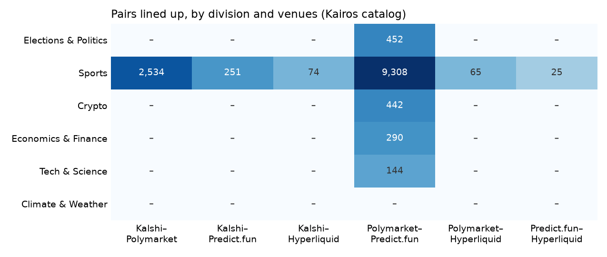
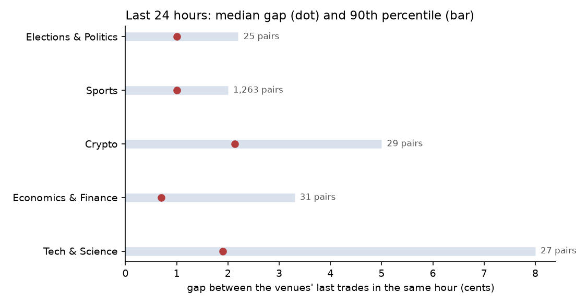
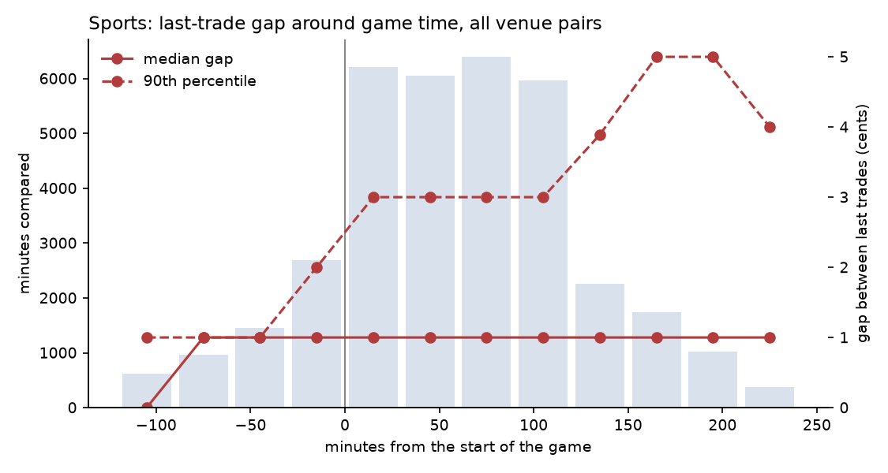

# Kairos cross-venue report, 2026-10-18

Generated 2026-10-18 15:28 UTC from Kairos's matched-market catalog, Market Data API and fee quotes, and Kalshi and Polymarket order books. Pairs are grouped into [Prediction@Illinois](https://prediction-illinois.github.io)'s six market divisions by Kairos's own categories.

## Overview

| Division | Pairs Kairos lists | Lined up | Edge after fees, confirmed | Median gap, last 24 h | Settled the same way, last 7 days |
|---|---|---|---|---|---|
| Elections & Politics | 456 | 456 | 2 of 188 | 1.0¢ (31 pairs) | 2 of 2 |
| Sports | 11,985 | 11,924 | 2 of 3,344 | 1.0¢ (975 pairs) | 14,480 of 14,498 |
| Crypto | 373 | 373 | 0 of 272 | 2.0¢ (34 pairs) | 375 of 375 |
| Economics & Finance | 285 | 285 | 0 of 189 | 0.5¢ (16 pairs) | 1 of 1 |
| Tech & Science | 141 | 141 | 0 of 66 | 2.0¢ (19 pairs) | 9 of 9 |
| Climate & Weather | 0 | 0 | – | – | – |

Another 22 pairs fall outside the six divisions (Culture 22).

## Pairs

Kairos listed 13,262 matched pairs across 6 venue combinations; oracle3-extras lined up the outcomes of 13,201 (100%), 81 of them with a warning such as a postponed game.

| Division | Venues | Lined up |
|---|---|---|
| Elections & Politics | Polymarket–Predict.fun | 456 of 456 |
| Sports | Polymarket–Predict.fun | 9,363 of 9,366 |
| Sports | Kalshi–Polymarket | 2,101 of 2,150 |
| Sports | Kalshi–Predict.fun | 316 of 320 |
| Sports | Kalshi–Hyperliquid | 68 of 68 |
| Sports | Polymarket–Hyperliquid | 54 of 56 |
| Sports | Predict.fun–Hyperliquid | 22 of 25 |
| Crypto | Polymarket–Predict.fun | 373 of 373 |
| Economics & Finance | Polymarket–Predict.fun | 285 of 285 |
| Tech & Science | Polymarket–Predict.fun | 141 of 141 |
| Other | Polymarket–Predict.fun | 22 of 22 |

| Not lined up | Pairs |
|---|---|
| different dates | 33 |
| could not confirm both markets ask about the same team | 8 |
| Kalshi market is inactive | 5 |
| Kalshi market is finalized | 4 |
| could not line up the outcomes | 4 |
| different events | 3 |
| could not tell which outcome is the Kalshi YES outcome | 2 |
| name and team-code checks point to different outcomes | 1 |
| Polymarket market not found | 1 |

## Live check

Each pair is priced on both venues and checked for a basket that pays more than it costs after both venues' fees. Kalshi and Polymarket have public order books, so their edges are walked down the books. Predict.fun is priced from its last trades, which can be weeks old; the largest of those edges are confirmed with Kairos fee quotes, which walk the live Predict.fun book.

| Division | Priced on live books | Edge after fees | Left after the books | Priced from last trades | Edge on last trades | Checked with fee quotes | Confirmed |
|---|---|---|---|---|---|---|---|
| Elections & Politics | 0 | 0 | 0 | 188 | 114 | 15 | 2 |
| Sports | 2,101 | 16 | 2 | 1,243 | 530 | 11 | 0 |
| Crypto | 0 | 0 | 0 | 272 | 152 | 7 | 0 |
| Economics & Finance | 0 | 0 | 0 | 189 | 121 | 10 | 0 |
| Tech & Science | 0 | 0 | 0 | 66 | 38 | 5 | 0 |
| Other | 0 | 0 | 0 | 19 | 11 | 2 | 0 |

Not priced: no Predict.fun trades yet 8,979; no live quotes for Hyperliquid yet 144.

| Division | Venues | Market A | Market B | Basket | Contracts | Net edge | Checked with | Closes |
|---|---|---|---|---|---|---|---|---|
| Sports | Kalshi–Polymarket | Holger Rune wins | European Open: Holger Rune vs Raphael Collignon | NO on A + YES on B | 21036.19 | $1056.6206 | order books | 2026-10-26 |
| Elections & Politics | Polymarket–Predict.fun | Will John Fetterman win the 2028 Democratic presidential nomination? | Will John Fetterman win the 2028 Democratic presidential nomination? | YES on A + NO on B | 250.0 | $0.2300 | Kairos fee quotes | 2028-11-08 |
| Elections & Politics | Polymarket–Predict.fun | Will Oprah Winfrey win the 2028 Democratic presidential nomination? | Will Oprah Winfrey win the 2028 Democratic presidential nomination? | YES on A + NO on B | 250.0 | $0.2300 | Kairos fee quotes | 2028-11-08 |
| Sports | Kalshi–Polymarket | Will Virtus.pro win the Team Risk vs. Virtus.pro Overwatch match? | Overwatch: Virtus.pro vs Team Risk (BO5) - OCS EMEA Stage 3 Group Stage | NO on A + YES on B | 0.05 | $0.0014 | order books | 2026-10-18 |

Net edge is for all the contracts together. It assumes every leg fills at the prices used, both markets settle the same way, and money tied up until settlement costs nothing, which matters for markets that close years from now. Closes is the earlier of the two markets' closing times.

Most edges at the top of the book disappear after fees, in the order books, or once a stale last trade meets the live book.

## Price agreement, last 24 hours

For every pair, both venues' last trades in each hour of the last 24 hours, up to the event's start (a game under way is compared on its pre-game prices only).

| Division | Pairs compared | Hours compared | Median gap | 90th percentile | Hours 2¢ or more apart |
|---|---|---|---|---|---|
| Elections & Politics | 31 | 90 | 1.0¢ | 2.0¢ | 26% |
| Sports | 975 | 4,135 | 1.0¢ | 2.0¢ | 15% |
| Crypto | 34 | 45 | 2.0¢ | 5.0¢ | 56% |
| Economics & Finance | 16 | 49 | 0.5¢ | 3.1¢ | 14% |
| Tech & Science | 19 | 43 | 2.0¢ | 7.0¢ | 56% |
| Other | 2 | 12 | 0.6¢ | 0.8¢ | 0% |

| Division | Venues | Pairs compared | Median gap | 90th percentile |
|---|---|---|---|---|
| Elections & Politics | Polymarket–Predict.fun | 31 | 1.0¢ | 2.0¢ |
| Sports | Kalshi–Polymarket | 441 | 1.0¢ | 2.0¢ |
| Sports | Kalshi–Predict.fun | 53 | 1.0¢ | 2.0¢ |
| Sports | Polymarket–Predict.fun | 481 | 0.8¢ | 2.0¢ |
| Crypto | Polymarket–Predict.fun | 34 | 2.0¢ | 5.0¢ |
| Economics & Finance | Polymarket–Predict.fun | 16 | 0.5¢ | 3.1¢ |
| Tech & Science | Polymarket–Predict.fun | 19 | 2.0¢ | 7.0¢ |
| Other | Polymarket–Predict.fun | 2 | 0.6¢ | 0.8¢ |

| Most persistent gaps (at least 3 hours compared) | Division | Venues | Median gap | Hours |
|---|---|---|---|---|
| Tesla and SpaceX merger officially announced by January 31, 2027? | Tech & Science | Polymarket–Predict.fun | 7.0¢ | 3 |
| UFC 333: Abubakar Vagaev vs. Jacob Malkoun (Middleweight, Early Prelims) | Sports | Kalshi–Polymarket | 6.0¢ | 3 |
| Next Fable Model (5.2+) released by October 21, 2026? | Tech & Science | Polymarket–Predict.fun | 5.5¢ | 4 |
| UFC 333: Colby Thicknesse vs. Asaf Chopurov (Bantamweight, Early Prelims) | Sports | Kalshi–Polymarket | 5.0¢ | 6 |
| W15 Campina Grande: Maria Paula Manrique vs Olivia Elliott | Sports | Kalshi–Polymarket | 5.0¢ | 5 |
| Ink FDV above $250M one day after launch? | Crypto | Polymarket–Predict.fun | 4.1¢ | 3 |
| Next Fable Model (5.2+) released by October 24, 2026? | Tech & Science | Polymarket–Predict.fun | 3.0¢ | 8 |
| Felix Protocol FDV above $100M one day after launch? | Crypto | Polymarket–Predict.fun | 2.7¢ | 3 |

## Sports around game time

Games that started 6 to 30 hours ago: 1,950 of 4,362 pairs traded on both venues in the same minute, 49,215 minutes in all. The median gap between the two last trades was 1.0¢ and the 90th percentile 3.0¢; before the start the 90th percentile was 1.0¢.

| Venues | Pairs compared | Minutes | Median gap | 90th percentile |
|---|---|---|---|---|
| Kalshi–Polymarket | 1,147 | 31,979 | 1.0¢ | 3.0¢ |
| Polymarket–Predict.fun | 803 | 17,236 | 1.0¢ | 3.0¢ |

| Most persistent gaps (at least 10 minutes compared) | Venues | Median gap | Largest | Minutes |
|---|---|---|---|---|
| Tampa Bay Rays vs. Cleveland Guardians | Polymarket–Predict.fun | 11¢ | 46¢ | 218 |
| Tampa Bay Rays vs. Cleveland Guardians | Kalshi–Polymarket | 9.0¢ | 47¢ | 228 |
| Tampa Bay Rays vs. Cleveland Guardians: O/U 5.5 | Kalshi–Polymarket | 10¢ | 28¢ | 13 |
| Dota 2: LFO vs Spirit Academy - Game 2 Winner | Polymarket–Predict.fun | 7.8¢ | 50¢ | 12 |
| Counter-Strike: EAC Extra vs RoundsGG - Map 1 Winner | Polymarket–Predict.fun | 7.0¢ | 45¢ | 14 |

These are trade prices up to a minute apart, not quotes: a gap shows the venues disagreeing, not an arbitrage that could have been executed.

## Trading activity

24-hour volume from Kairos trade metrics for up to 40 pairs per division, chosen at random each day.

| Division | Venue | Markets sampled | Traded in the last 24 h | Median 24 h volume of those |
|---|---|---|---|---|
| Elections & Politics | Polymarket | 40 | 22 of 40 | $238 |
| Elections & Politics | Predict.fun | 40 | 2 of 40 | $89,188 |
| Sports | Kalshi | 8 | 3 of 8 | $69,758 |
| Sports | Polymarket | 39 | 4 of 39 | $387 |
| Sports | Predict.fun | 33 | 4 of 33 | $67.81 |
| Crypto | Polymarket | 40 | 16 of 40 | $194 |
| Crypto | Predict.fun | 40 | 4 of 40 | $1,701 |
| Economics & Finance | Polymarket | 40 | 21 of 40 | $304 |
| Economics & Finance | Predict.fun | 40 | 3 of 40 | $182 |
| Tech & Science | Polymarket | 40 | 27 of 40 | $167 |
| Tech & Science | Predict.fun | 40 | 10 of 40 | $369 |
| Other | Polymarket | 22 | 8 of 22 | $416 |
| Other | Predict.fun | 22 | 2 of 22 | $19,372 |

## Settlement

Events that started in the last seven days: 14,885 pairs have settled on both venues and 14,867 settled the same way (100%); 280 are still settling or have no result from Kairos.

| Division | Settled on both venues | Same way | Still settling |
|---|---|---|---|
| Elections & Politics | 2 | 2 | 0 |
| Sports | 14,498 | 14,480 | 280 |
| Crypto | 375 | 375 | 0 |
| Economics & Finance | 1 | 1 | 0 |
| Tech & Science | 9 | 9 | 0 |

| Venue | Markets looked up | Resolved |
|---|---|---|
| Kalshi | 4,688 | 4,670 |
| Polymarket | 14,743 | 14,699 |
| Predict.fun | 10,681 | 10,654 |
| Hyperliquid | 218 | 0 |

| Market A | Market B | Venues | A first outcome paid | B first outcome paid |
|---|---|---|---|---|
| Ann Li wins | Wuhan Tennis Open: Ann Li vs Qinwen Zheng | kalshi + polymarket | 0.29 | 0.5 |
| Belinda Bencic wins | Wuhan Tennis Open: Belinda Bencic vs Shuai Zhang | kalshi + polymarket | 0.82 | 0.5 |
| Iva Jovic wins | Wuhan Tennis Open: Iva Jovic vs Mia Pohankova | kalshi + polymarket | 0.85 | 0.5 |
| Diane Parry wins | Wuhan Tennis Open: Diane Parry vs Anna Kalinskaya | kalshi + polymarket | 0.35 | 0.5 |
| Janice Tjen wins | Wuhan Tennis Open: Janice Tjen vs Oleksandra Oliynykova | kalshi + polymarket | 0.72 | 0.5 |
| Anna Kalinskaya wins | Wuhan Tennis Open: Anna Kalinskaya vs Shuai Zhang | kalshi + polymarket | 0.68 | 0.5 |
| Copenhagen Wolves wins | Counter-Strike: Copenhagen Wolves vs RoundsGG (BO3) - European Pro League Regular Playoffs | kalshi + polymarket | 0.59 | 0.5 |
| Copenhagen Wolves wins | Counter-Strike: Copenhagen Wolves vs RoundsGG (BO3) - European Pro League Regular Playoffs | kalshi + predictfun | 0.59 | 0.5 |
| STATE wins | Counter-Strike: STATE vs TheChampionGG (BO3) - United21 Group B | kalshi + polymarket | 0.58 | 0.5 |
| RED Canids Academy wins | Counter-Strike: RED Canids Academy vs realgotis22 (BO3) - CCT South America Series 7 Group Stage | kalshi + polymarket | 0.67 | 0.5 |

## Notes for Kairos

- No matched pairs in Climate & Weather.
- Every Kalshi pair (2,538) is Sports.
- Every Hyperliquid pair (149) is Sports.
- 165 pairs carry a different category on each side (87 of them point to different divisions); for example "Adan Freire Da Silva wins" is Sports on Kalshi and Crypto on Polymarket; "Butler wins" is Sports on Kalshi and Culture on Polymarket; "Will a team from LPL (China) win LoL Worlds 2026?" is World on Polymarket and Esports on Predict.fun.
- 1,281 pairs have a category on one side only (side without one: Polymarket 1,281).
- 33 Kalshi–Polymarket pairs are matched across different dates; for example "Daniel Altmaier wins" and "Lyon Open: Daniel Altmaier vs Titouan Droguet" (Kalshi 2026-10-18, Polymarket starts 2026-10-20 08:00Z).
- 3 Polymarket–Predict.fun pairs are matched across different events; for example "Athletic Club leading at halftime?" (lal-ray-bil-2026-10-10-halftime-result vs lal-lev-bil-2026-09-16-halftime-result).
- 25 more pairs could not be confirmed automatically and were left out (see "Not lined up" above).
- 8,979 of 10,978 pairs with a Predict.fun side have no Predict.fun trades yet (no mark), so they cannot be priced.
- No resolutions came back for Hyperliquid (218 markets whose events started 6 hours to 7 days before the report).

## Method

- Pairs come from Kairos `/matched-markets`; [oracle3-extras](https://github.com/YichengYang-Ethan/oracle3-extras) checks each one on both venues and decides which outcome of market B pays when market A's first outcome pays.
- Divisions follow Kairos's categories (Politics and World: Elections & Politics; Sports and Esports: Sports; Finance: Economics & Finance; Tech and Science: Tech & Science). When the two sides disagree, Sports comes first, then Climate & Weather, Economics & Finance, Elections & Politics, Tech & Science and Crypto.
- The live check uses each venue's published fee schedule (oracle3), Kalshi and Polymarket order books, Kairos marks for Predict.fun last trades and Kairos fee quotes to confirm them.
- Price agreement uses Kairos hourly candles; the sports section uses one-minute candles; trading activity uses `/v1/trades/metrics`; settlement uses `/v1/resolutions`.
- Only aggregates and a few example rows are published here.
