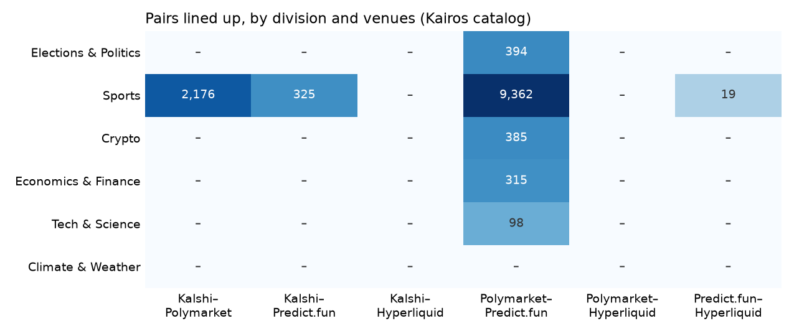
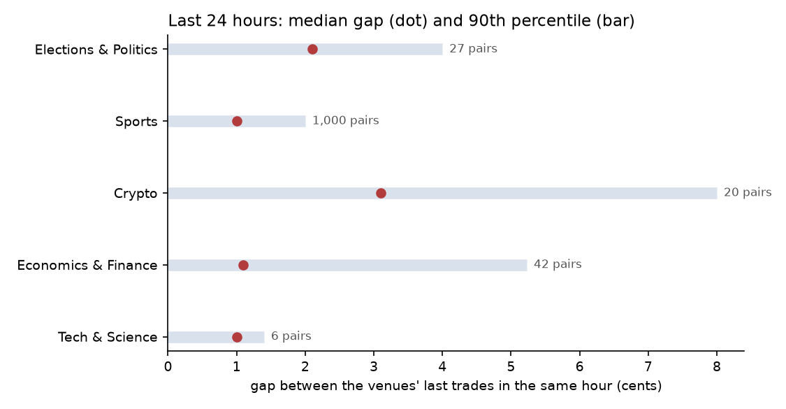
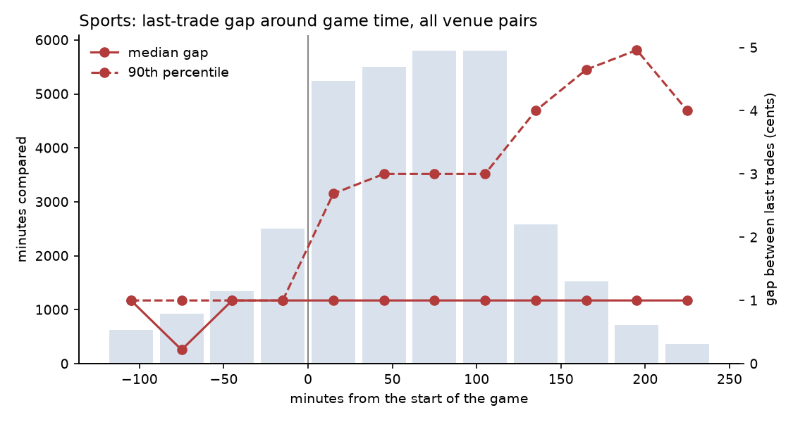

# Kairos cross-venue report, 2026-11-10

Generated 2026-11-10 19:24 UTC from Kairos's matched-market catalog, Market Data API and fee quotes, and Kalshi and Polymarket order books. Pairs are grouped into [Prediction@Illinois](https://prediction-illinois.github.io)'s six market divisions by Kairos's own categories.

## Overview

| Division | Pairs Kairos lists | Lined up | Edge after fees, confirmed | Median gap, last 24 h | Settled the same way, last 7 days |
|---|---|---|---|---|---|
| Elections & Politics | 392 | 392 | 0 of 178 | 1.1¢ (13 pairs) | 117 of 117 |
| Sports | 10,947 | 10,792 | 3 of 2,996 | 1.0¢ (705 pairs) | 18,190 of 18,274 |
| Crypto | 381 | 381 | 0 of 274 | 1.4¢ (28 pairs) | – |
| Economics & Finance | 310 | 310 | 0 of 191 | 2.0¢ (72 pairs) | – |
| Tech & Science | 93 | 93 | 0 of 49 | 2.0¢ (6 pairs) | 2 of 2 |
| Climate & Weather | 0 | 0 | – | – | – |

Another 207 pairs fall outside the six divisions (Culture 202, no category 5).

## Pairs

Kairos listed 12,330 matched pairs across 6 venue combinations; oracle3-extras lined up the outcomes of 12,170 (99%), 75 of them with a warning such as a postponed game.

| Division | Venues | Lined up |
|---|---|---|
| Elections & Politics | Polymarket–Predict.fun | 392 of 392 |
| Sports | Polymarket–Predict.fun | 8,355 of 8,355 |
| Sports | Kalshi–Polymarket | 2,094 of 2,102 |
| Sports | Kalshi–Predict.fun | 326 of 329 |
| Sports | Kalshi–Hyperliquid | 0 of 98 |
| Sports | Polymarket–Hyperliquid | 0 of 46 |
| Sports | Predict.fun–Hyperliquid | 17 of 17 |
| Crypto | Polymarket–Predict.fun | 381 of 381 |
| Economics & Finance | Polymarket–Predict.fun | 310 of 310 |
| Tech & Science | Polymarket–Predict.fun | 93 of 93 |
| Other | Polymarket–Predict.fun | 202 of 202 |
| Other | Polymarket–Hyperliquid | 0 of 5 |

| Not lined up | Pairs |
|---|---|
| different dates | 149 |
| could not confirm both markets ask about the same team | 4 |
| different start times | 3 |
| Kalshi market is inactive | 2 |
| could not tell which outcome is the Kalshi YES outcome | 2 |

## Live check

Each pair is priced on both venues and checked for a basket that pays more than it costs after both venues' fees. Kalshi and Polymarket have public order books, so their edges are walked down the books. Predict.fun is priced from its last trades, which can be weeks old; the largest of those edges are confirmed with Kairos fee quotes, which walk the live Predict.fun book.

| Division | Priced on live books | Edge after fees | Left after the books | Priced from last trades | Edge on last trades | Checked with fee quotes | Confirmed |
|---|---|---|---|---|---|---|---|
| Elections & Politics | 0 | 0 | 0 | 178 | 143 | 13 | 0 |
| Sports | 2,094 | 9 | 3 | 902 | 403 | 8 | 0 |
| Crypto | 0 | 0 | 0 | 274 | 137 | 5 | 0 |
| Economics & Finance | 0 | 0 | 0 | 191 | 143 | 14 | 0 |
| Tech & Science | 0 | 0 | 0 | 49 | 33 | 3 | 0 |
| Other | 0 | 0 | 0 | 45 | 30 | 7 | 0 |

Not priced: no Predict.fun trades yet 8,420; no live quotes for Hyperliquid yet 17.

| Division | Venues | Market A | Market B | Basket | Contracts | Net edge | Checked with | Closes |
|---|---|---|---|---|---|---|---|---|
| Sports | Kalshi–Polymarket | Ia Reyes Romero wins | W50 Chihuahua: Ia Reyes Romero vs Despina Papamichail | NO on A + YES on B | 15.24 | $0.0280 | order books | 2026-11-17 |
| Sports | Kalshi–Polymarket | Nothin'Here wins | LoL: Nothin'Here vs Saigon Warriors (BO5) - LCP Promotion Playoffs | YES on A + NO on B | 1.53 | $0.0011 | order books | 2026-11-12 |
| Sports | Kalshi–Polymarket | Madhwin Kamath wins | M15 Kuala Lumpur: Madhwin Kamath vs Kazuma Kawachi | YES on A + NO on B | 0.01 | $0.0003 | order books | 2026-11-18 |

Net edge is for all the contracts together. It assumes every leg fills at the prices used, both markets settle the same way, and money tied up until settlement costs nothing, which matters for markets that close years from now. Closes is the earlier of the two markets' closing times.

Most edges at the top of the book disappear after fees, in the order books, or once a stale last trade meets the live book.

## Price agreement, last 24 hours

For every pair, both venues' last trades in each hour of the last 24 hours, up to the event's start (a game under way is compared on its pre-game prices only).

| Division | Pairs compared | Hours compared | Median gap | 90th percentile | Hours 2¢ or more apart |
|---|---|---|---|---|---|
| Elections & Politics | 13 | 18 | 1.1¢ | 6.3¢ | 39% |
| Sports | 705 | 3,255 | 1.0¢ | 2.1¢ | 23% |
| Crypto | 28 | 33 | 1.4¢ | 4.9¢ | 36% |
| Economics & Finance | 72 | 228 | 2.0¢ | 11¢ | 53% |
| Tech & Science | 6 | 7 | 2.0¢ | 28¢ | 57% |
| Other | 14 | 52 | 0.9¢ | 4.0¢ | 38% |

| Division | Venues | Pairs compared | Median gap | 90th percentile |
|---|---|---|---|---|
| Elections & Politics | Polymarket–Predict.fun | 13 | 1.1¢ | 6.3¢ |
| Sports | Kalshi–Polymarket | 397 | 1.0¢ | 2.6¢ |
| Sports | Kalshi–Predict.fun | 62 | 1.0¢ | 2.0¢ |
| Sports | Polymarket–Predict.fun | 240 | 1.0¢ | 2.0¢ |
| Sports | Predict.fun–Hyperliquid | 6 | 0.4¢ | 1.2¢ |
| Crypto | Polymarket–Predict.fun | 28 | 1.4¢ | 4.9¢ |
| Economics & Finance | Polymarket–Predict.fun | 72 | 2.0¢ | 11¢ |
| Tech & Science | Polymarket–Predict.fun | 6 | 2.0¢ | 28¢ |
| Other | Polymarket–Predict.fun | 14 | 0.9¢ | 4.0¢ |

| Most persistent gaps (at least 3 hours compared) | Division | Venues | Median gap | Hours |
|---|---|---|---|---|
| Will Anthropic’s market cap be between 0.9T and 1.2T at market close on IPO day by December 31 2027? | Economics & Finance | Polymarket–Predict.fun | 21¢ | 3 |
| Will OpenAI's IPO valuation be between $2.0T and $2.25T? | Economics & Finance | Polymarket–Predict.fun | 14¢ | 6 |
| Valorant: BOOM Esports vs Rojali (BO3) - Asia Pacific Predator League Indonesia Playoffs | Sports | Kalshi–Predict.fun | 12¢ | 3 |
| Counter-Strike: DimoniX Esports vs Spirit HU (BO1) - ESEA Advanced Europe Regular Season | Sports | Kalshi–Polymarket | 8.0¢ | 9 |
| Dota 2: PlayTime vs Team Synapse (BO3) - DreamLeague Division 2 Group A | Sports | Kalshi–Polymarket | 7.3¢ | 3 |
| Will J.D. Vance win the 2028 Republican presidential nomination? | Elections & Politics | Polymarket–Predict.fun | 5.0¢ | 3 |
| Will WaiterG win the GMGN GGC Season 1 Grand Final? | Other | Polymarket–Predict.fun | 3.7¢ | 3 |
| Will Anthropic’s market cap be between 1.2T and 1.5T at market close on IPO day by December 31 2027? | Economics & Finance | Polymarket–Predict.fun | 3.5¢ | 6 |

## Sports around game time

Games that started 6 to 30 hours ago: 775 of 1,359 pairs traded on both venues in the same minute, 21,876 minutes in all. The median gap between the two last trades was 1.0¢ and the 90th percentile 4.0¢; before the start the 90th percentile was 2.0¢.

| Venues | Pairs compared | Minutes | Median gap | 90th percentile |
|---|---|---|---|---|
| Kalshi–Polymarket | 578 | 18,077 | 1.0¢ | 4.0¢ |
| Polymarket–Predict.fun | 197 | 3,799 | 1.0¢ | 5.0¢ |

| Most persistent gaps (at least 10 minutes compared) | Venues | Median gap | Largest | Minutes |
|---|---|---|---|---|
| Valorant: BOOM Esports vs Rojali (BO3) - Asia Pacific Predator League Indonesia Playoffs | Kalshi–Polymarket | 8.0¢ | 19¢ | 22 |
| TPS Turku vs. KalPa Hockey | Kalshi–Polymarket | 5.0¢ | 20¢ | 14 |
| Counter-Strike: NAVI Junior vs Sökerorg (BO3) - European Pro League Group C | Kalshi–Polymarket | 5.0¢ | 22¢ | 40 |
| Dota 2: Nemiga Gaming vs Zenith - Game 2 Winner | Polymarket–Predict.fun | 4.0¢ | 24¢ | 10 |
| Counter-Strike: Linx Legacy Esport vs ECSTATIC (BO1) - Dust2.dk Ligaen Regular Season | Kalshi–Polymarket | 4.0¢ | 22¢ | 22 |

These are trade prices up to a minute apart, not quotes: a gap shows the venues disagreeing, not an arbitrage that could have been executed.

## Trading activity

24-hour volume from Kairos trade metrics for up to 40 pairs per division, chosen at random each day.

| Division | Venue | Markets sampled | Traded in the last 24 h | Median 24 h volume of those |
|---|---|---|---|---|
| Elections & Politics | Polymarket | 40 | 26 of 40 | $242 |
| Elections & Politics | Predict.fun | 40 | 0 of 40 | – |
| Sports | Kalshi | 7 | 3 of 7 | $14,788 |
| Sports | Polymarket | 39 | 10 of 39 | $34.62 |
| Sports | Predict.fun | 34 | 5 of 34 | $18.18 |
| Crypto | Polymarket | 40 | 15 of 40 | $68.68 |
| Crypto | Predict.fun | 40 | 8 of 40 | $170 |
| Economics & Finance | Polymarket | 40 | 26 of 40 | $3,080 |
| Economics & Finance | Predict.fun | 40 | 8 of 40 | $23.95 |
| Tech & Science | Polymarket | 40 | 24 of 40 | $455 |
| Tech & Science | Predict.fun | 40 | 2 of 40 | $128 |
| Other | Polymarket | 40 | 20 of 40 | $312 |
| Other | Predict.fun | 40 | 2 of 40 | $98.89 |

## Settlement

Events that started in the last seven days: 18,396 pairs have settled on both venues and 18,312 settled the same way (100%); 219 are still settling or have no result from Kairos.

| Division | Settled on both venues | Same way | Still settling |
|---|---|---|---|
| Elections & Politics | 117 | 117 | 14 |
| Sports | 18,274 | 18,190 | 205 |
| Tech & Science | 2 | 2 | 0 |
| Other | 3 | 3 | 0 |

| Venue | Markets looked up | Resolved |
|---|---|---|
| Kalshi | 6,144 | 6,089 |
| Polymarket | 17,882 | 17,744 |
| Predict.fun | 13,184 | 13,067 |
| Hyperliquid | 20 | 0 |

| Market A | Market B | Venues | A first outcome paid | B first outcome paid |
|---|---|---|---|---|
| Alexander Bublik wins | Almaty Open: Alexander Bublik vs Fabian Marozsan | kalshi + predictfun | 0.72 | 0.5 |
| Abha wins | Will Abha Saudi Club win on 2026-11-05? | kalshi + polymarket | 0.19 | 0.0 |
| Al-Shabab wins | Will Al Shabab Saudi Club win on 2026-11-05? | kalshi + polymarket | 0.59 | 0.0 |
| Tie is the result | Will Abha Saudi Club vs. Al Shabab Saudi Club end in a draw? | kalshi + polymarket | 0.22 | 1.0 |
| Tie is the result | Will Abha Saudi Club vs. Al Shabab Saudi Club end in a draw? | kalshi + predictfun | 0.22 | 1.0 |
| Al-Fayha wins | Will Al Fayha Saudi Club win on 2026-11-05? | kalshi + polymarket | 0.08 | 0.0 |
| Al Qadsiah wins | Will Al Qadisiyah Saudi Club win on 2026-11-05? | kalshi + polymarket | 0.69 | 0.0 |
| Tie is the result | Will Al Qadisiyah Saudi Club vs. Al Fayha Saudi Club end in a draw? | kalshi + polymarket | 0.23 | 1.0 |
| Tie is the result | Will Al Qadisiyah Saudi Club vs. Al Fayha Saudi Club end in a draw? | kalshi + predictfun | 0.23 | 1.0 |
| Al-Fateh wins | Will Al Fateh Saudi Club win on 2026-11-06? | kalshi + polymarket | 0.4 | 0.0 |

## Notes for Kairos

- No matched pairs in Climate & Weather.
- Every Kalshi pair (2,529) is Sports.
- 564 pairs carry a different category on each side (452 of them point to different divisions); for example "Fernanda Guadalupe Regalado Macias wins" is Sports on Kalshi and Crypto on Polymarket; "Drake wins" is Sports on Kalshi and Culture on Polymarket; "Israel wins" is Sports on Kalshi and World on Polymarket.
- 4,959 pairs have a category on one side only (side without one: Polymarket 4,954, Predict.fun 4, Hyperliquid 1).
- 98 Kalshi–Hyperliquid pairs are matched across different dates; for example "Philadelphia wins" and "NBA Regular Season: Philadelphia 76ers v Boston Celtics" (Kalshi 2026-11-10, Hyperliquid 2026-11-17).
- 51 Polymarket–Hyperliquid pairs are matched across different dates; for example "Will Türkiye win on 2026-11-12?" and "UEFA Nations League A, Matchday 5: Turkiye v Belgium: Turkiye" (Polymarket 2026-11-12, Hyperliquid 2026-11-19).
- 3 Kalshi–Polymarket pairs are matched across different start times; for example "Young TigeRES wins" and "Counter-Strike: Young TigeRES vs OLDBOYS- (BO1) - ESEA Advanced Europe Regular Season" (Kalshi 2026-11-10 19:30Z, Polymarket 2026-11-17 18:30Z).
- 8 more pairs could not be confirmed automatically and were left out (see "Not lined up" above).
- 8,420 of 10,076 pairs with a Predict.fun side have no Predict.fun trades yet (no mark), so they cannot be priced.
- No resolutions came back for Hyperliquid (20 markets whose events started 6 hours to 7 days before the report).

## Method

- Pairs come from Kairos `/matched-markets`; [oracle3-extras](https://github.com/YichengYang-Ethan/oracle3-extras) checks each one on both venues and decides which outcome of market B pays when market A's first outcome pays.
- Divisions follow Kairos's categories (Politics and World: Elections & Politics; Sports and Esports: Sports; Finance: Economics & Finance; Tech and Science: Tech & Science). When the two sides disagree, Sports comes first, then Climate & Weather, Economics & Finance, Elections & Politics, Tech & Science and Crypto.
- The live check uses each venue's published fee schedule (oracle3), Kalshi and Polymarket order books, Kairos marks for Predict.fun last trades and Kairos fee quotes to confirm them.
- Price agreement uses Kairos hourly candles; the sports section uses one-minute candles; trading activity uses `/v1/trades/metrics`; settlement uses `/v1/resolutions`.
- Only aggregates and a few example rows are published here.
